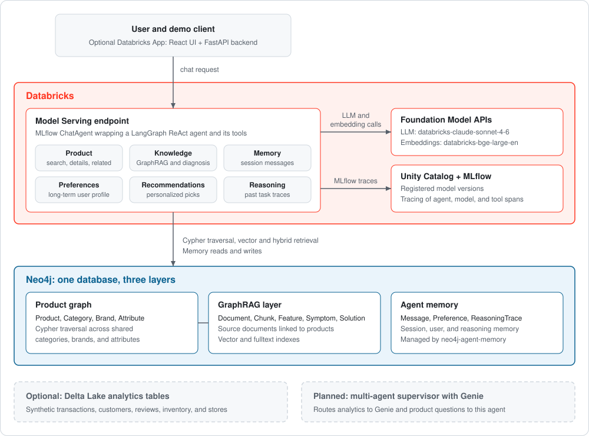
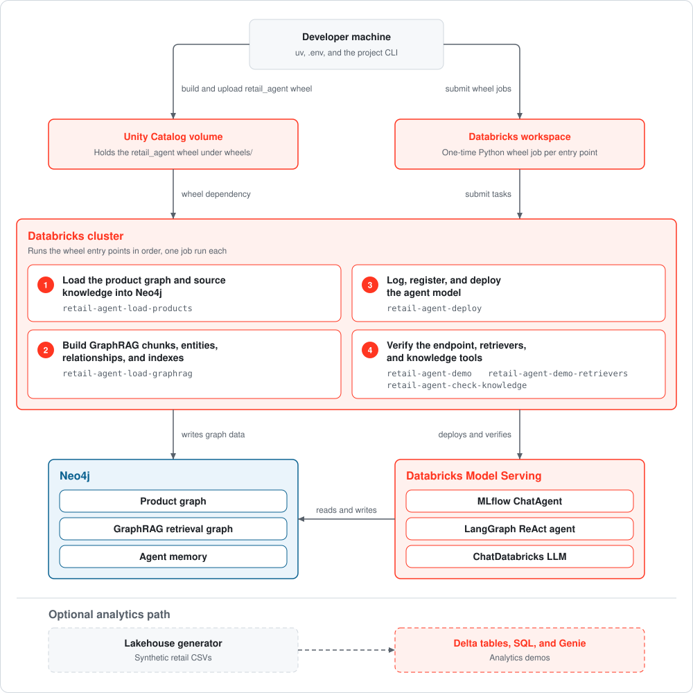

# Agentic Commerce

Agentic Commerce is a sample solution that pairs Neo4j with Databricks to build a retail shopping assistant. The assistant searches products, diagnoses product issues, answers support questions, and remembers each customer's preferences across sessions.

Neo4j supplies the connected data. A product knowledge graph, a GraphRAG retrieval layer, and persistent agent memory live together in one database. Databricks supplies the AI platform: model serving, LLM inference, embeddings, and governance.

## Why a Graph for Retail AI

Retail recommendation and support systems built on flat data models hit a ceiling quickly. Vector search finds semantically similar products. It cannot answer a question like this one:

> Which products in the customer's preferred brand also have the performance attributes they care about, and what issues have other customers reported with those specific models?

That question requires traversing relationships, not ranking embeddings. This sample treats product data, support knowledge, and customer memory as one connected graph. The agent grounds each answer in structured product relationships and in unstructured knowledge content.

## What It Demonstrates

- **Knowledge graph for product discovery:** Products connect to categories, brands, and attributes as first-class graph nodes. The agent follows those relationships to find related, similar, and frequently bought together products.
- **GraphRAG for grounded support answers:** Support tickets, reviews, and knowledge articles link directly to the products they describe. Retrieval combines semantic search with graph traversal, so answers are more specific than a flat vector index returns on the same content.
- **Agent memory in the graph:** Customer preferences, conversation messages, and reasoning traces accumulate as a persistent subgraph. The agent retrieves them by semantic similarity across sessions, with no model fine-tuning.
- **Personalized recommendations:** The agent combines a customer's stored preferences with knowledge graph traversal to recommend products.
- **Governed deployment on Databricks:** The agent runs as an MLflow ChatAgent on Model Serving. Unity Catalog holds its registered model versions.

## Solution Architecture



Neo4j owns the relationship and retrieval layer. Databricks owns inference, deployment, and model lifecycle.

### What Neo4j Provides

- **Cypher traversal:** A multi-hop product relationship query is a single Cypher statement. The SQL equivalent is a chain of joins that grows with each hop.
- **GraphRAG layer:** Source knowledge documents are chunked, their entities and symptoms are extracted, and the resulting nodes link back to the product graph. Retrieval uses both vector similarity and graph proximity.
- **Agent memory:** Messages, preferences, and reasoning traces are stored as graph nodes. They accumulate across sessions next to the product data they refer to.

### What Databricks Provides

- **Model Serving:** The agent runs as an MLflow ChatAgent, registered in Unity Catalog and deployed to a REST endpoint.
- **LLM inference:** `databricks-claude-sonnet-4-6` handles reasoning and generation.
- **Embeddings:** `databricks-bge-large-en` generates embeddings for both the GraphRAG index and the memory layer.
- **Unity Catalog:** Unity Catalog holds the registered model versions and the wheel artifacts that Databricks Jobs use to load and build the graph.
- **Delta Lake:** Optional Delta tables hold synthetic retail data for SQL and Genie-style analytics demos.

### Agent Tools

The agent is a LangGraph ReAct agent that chooses among these tool groups on each turn.

| Tool group | Purpose |
|------------|---------|
| Product tools | Product search, product details, related products |
| Knowledge tools | GraphRAG semantic search, hybrid keyword/vector search, product issue diagnosis |
| Memory tools | Session-scoped remember, recall, and semantic memory search |
| Preference tools | User-scoped long-term preference tracking and profile retrieval |
| Commerce tools | Preference-aware product recommendations using knowledge graph traversal |
| Reasoning tools | Store and recall multi-step reasoning traces |
| Diagnostics | Validate serving-time tool injection and Neo4j/memory initialization |

### Data Layers

| Layer | Main nodes and relationships | Built by |
|-------|------------------------------|----------|
| Product graph | `Product`, `Category`, `Brand`, `Attribute`; `IN_CATEGORY`, `MADE_BY`, `HAS_ATTRIBUTE`, `SIMILAR_TO`, `BOUGHT_TOGETHER` | `retail-agent-load-products` |
| Source knowledge | `KnowledgeArticle`, `SupportTicket`, `Review`; source document relationships to products | `retail-agent-load-products` |
| GraphRAG layer | `Document`, `Chunk`, `Feature`, `Symptom`, `Solution`; retrieval and product shortcut relationships | `retail-agent-load-graphrag` |
| Agent memory | `Message`, `Preference`, `ReasoningTrace` and memory vector indexes | `neo4j-agent-memory` at serving time |
| Lakehouse analytics | Generated retail CSVs uploaded as Delta tables for SQL and Genie demos | `retail_agent.scripts.generate_transactions`, `retail_agent.scripts.lakehouse_tables` |

## What This Repo Contains

- An MLflow `ChatAgent` model implemented in `retail_agent/agent/serving.py`.
- A LangGraph ReAct agent with product, knowledge, memory, preference, commerce, reasoning, and diagnostic tools.
- Databricks job entry points for product graph loading, GraphRAG loading, model deployment, and endpoint verification.
- Neo4j graph schemas for product relationships, GraphRAG retrieval, and agent memory.
- Lakehouse data generation scripts for optional SQL and Genie-style analytics demos.
- A stub Mosaic AI multi-agent supervisor for future Genie plus KG-agent routing.
- An optional demo client with a web frontend and backend in `demo-client/`.

## What This Teaches

- How to deploy a LangGraph agent to Databricks Model Serving using MLflow's Models from Code pattern.
- How to use Neo4j as both a domain knowledge graph and an agent memory store in the same application.
- How to combine vector search with graph traversal to get more relevant retrieval results than either approach alone.
- How to plan a multi-agent system where a supervisor routes each question to a graph agent or a SQL agent, based on what each does well.
- How to manage secrets, async resources, and multi-tenant state in a serverless serving environment.

## Getting Started

You need a Databricks workspace, a Unity Catalog volume, access to the two model serving endpoints named above, and a Neo4j database reachable from Databricks. The runbook lists the full [prerequisites](docs/runbook.md#prerequisites) and the one-time [setup](docs/runbook.md#setup) steps.

After setup, one command loads the graph, builds the GraphRAG layer, deploys the agent, and verifies the endpoint:

```bash
uv run python -m cli pipeline --all
```

The [Deployment Runbook](docs/runbook.md) covers pipeline modes, step-by-step deployment, focused testing, and individual commands. To chat with the deployed agent from a browser, see the [demo client](demo-client/README.md).

## Deployment



The project CLI builds a local `retail_agent` wheel and uploads it to a Unity Catalog volume. It then submits Databricks Python wheel entry points with `databricks-job-runner`. The jobs load the product graph and source knowledge into Neo4j, build the GraphRAG layer, deploy the agent to Model Serving, and verify the endpoint.

## Project Structure

```text
cli/
|-- __init__.py                       # CLI commands wired to databricks-job-runner
`-- __main__.py                       # project CLI entry point

retail_agent/
|-- agent/                            # ChatAgent adapter, LangGraph agent, config, supervisor stub
|-- tools/                            # catalog, knowledge, memory, preferences, reasoning, commerce, diagnostics
|-- integrations/                     # Databricks and Neo4j integration helpers
|-- deployment/                       # Databricks wheel entry points
|-- demos/                            # endpoint and retriever checks
|-- data/                             # product catalog and source knowledge fixtures
`-- scripts/                          # lakehouse generation and secret setup helpers

demo-client/                          # optional frontend/backend demo client
docs/                                 # architecture and implementation notes
tests/                                # local tests
checks/                               # focused demo trace checks
scripts/                              # standalone secret setup script
```

## Docs

| Document | Description |
|----------|-------------|
| [Deployment Runbook](docs/runbook.md) | Prerequisites, setup, pipeline modes, step-by-step deployment, focused testing, and individual commands |
| [Agentic Commerce: GraphRAG Meets Agent Memory on Neo4j](docs/agentic-commerce.md) | Design background and architecture narrative |
| [Developer's Guide: GraphRAG on Databricks](docs/DevelopersGuideGraphRAG-Databricks.md) | Lower-level GraphRAG implementation notes |
| [Lakehouse Data](docs/lakehouse.md) | Optional SQL analytics data generation for Genie-style demos |
| [Supervisor Stub](docs/supervisor.md) | Future multi-agent supervisor design and implementation notes |
| [Tracing](docs/tracing.md) | MLflow Tracing on the serving endpoint, the demo trace contract, and tool timing troubleshooting |
| [Demo Client](demo-client/README.md) | Local run, runtime settings, backend smoke tests, and deployment of the optional demo client |
