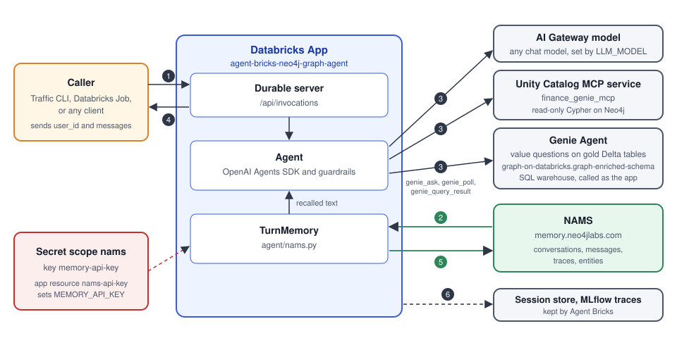

<style>
section {
  --marp-auto-scaling-code: false;
}

li {
  opacity: 1 !important;
  animation: none !important;
  visibility: visible !important;
}

.marp-fragment {
  opacity: 1 !important;
  visibility: visible !important;
}

ul > li,
ol > li {
  opacity: 1 !important;
}

.columns {
  display: grid;
  grid-template-columns: 1fr 1fr;
  gap: 32px;
  align-items: start;
}

.columns ul {
  margin-top: 0;
}

.placeholder {
  border: 3px dashed #9aa5b5;
  border-radius: 10px;
  color: #536174;
  font-size: 20px;
  line-height: 1.4;
  padding: 24px;
  text-align: center;
  min-height: 300px;
  display: flex;
  flex-direction: column;
  justify-content: center;
}

.placeholder strong {
  display: block;
  font-size: 22px;
  margin-bottom: 10px;
}

.small li,
.small p {
  font-size: 21px;
}

table {
  font-size: 20px;
}
</style>

# Agents That Remember: Databricks + Neo4j

**Databricks:** Agent Bricks, Genie, Databricks Apps, Unity Gateway, and MLflow Tracing

**Neo4j:** AuraDB, Neo4j GDS, the Neo4j MCP server, and the Neo4j Agent Memory Service

<!--
This is a joint story. Databricks builds, runs, and governs the agent.
Neo4j holds the domain graph the agent reasons over and the memory
graph the agent builds as it works. Neither side does the other's
job, and the talk shows where the line sits.

The talk builds and deploys an Agent Bricks agent that reads the
fraud graph through the Neo4j MCP service and remembers through the
Neo4j Agent Memory Service, NAMS for short. That gives two graphs: a
domain graph and a memory graph. Once both exist, Genie One can use
the same two MCP servers to answer natural language questions. The
ontology slides are in the backup, for questions about what typing
the memory graph changes.

The order is: the joint architecture, the fraud data, the Neo4j
half on agent memory and its demo, then the Databricks half and its
demo.

Product names were checked in October 2026. Genie Agents were called
Genie Spaces until July 2026, so say "Genie Agent" on stage even
though the repo and the API still say "space". AI Gateway became
Unity Gateway in August 2026. The diagram and the app config still
say AI Gateway for the model route.
-->

---

## Databricks + Neo4j: One Architecture for Agents That Remember

<div class="columns">
<div>

**Databricks runs and governs the agent**

- **Agent Bricks:** The CLI deploys the agent to a Databricks App.
- **Unity Catalog MCP service:** It allows read-only Cypher on the graph.
- **Genie Agent:** It answers value questions over the Gold tables.
- **AI Gateway model:** Any chat model writes the answer.
- **MLflow and sessions:** Every call is recorded.

</div>
<div>

**Neo4j holds what it knows and remembers**

- **AuraDB:** It holds the fraud graph.
- **Neo4j GDS:** Its scores are written back to the Gold tables.
- **Neo4j MCP server:** It sits behind the MCP service.
- **NAMS:** It stores conversations, reasoning traces, and entities.

</div>
</div>

<!--
Read the two column headers first. They are the whole talk in two
lines. Databricks runs and governs the agent. Neo4j holds what the
agent knows and what it remembers.

The agent itself is an OpenAI Agents SDK loop with two read-only
graph tools, get_neo4j_schema and read_neo4j_cypher, and the Genie
tools. The Genie tools are OpenAI Agents SDK function tools built
by genie_tools() in agent/agent.py, not MCP tools, so the Cypher
guardrails and the MCP allowlist do not apply to them. They run
with auth = "app", so Genie executes its SQL as the app's service
principal, not as the analyst. The caller sends messages, and in
the deployed app the identity comes from the Databricks Apps proxy.
The NAMS key lives in the secret scope nams, and the app reads it
as MEMORY_API_KEY.

The next slide is the diagram of the same parts. After it come
the fraud data, three slides on agent memory and NAMS, the memory
demo, two slides on the Databricks half, and the Databricks demo.
-->

---



<!--
Walk it by platform, not left to right. The blue app box and the
grey boxes on the right are Databricks: the app, the AI Gateway
model, the Unity Catalog MCP service, the Genie Agent, and the
session store with the MLflow traces. The green NAMS box is Neo4j,
and so is the graph behind the MCP service, which the diagram does
not draw.

Then walk the numbers. The caller sends a question to the app. The
app recalls memory from NAMS, runs the agent, and the agent reads
the graph through the MCP service and the Gold tables through the
Genie Agent. The answer goes back to the caller, and then the app
writes the turn to NAMS. Agent Bricks keeps the session store and
the MLflow traces on its own.

The "Durable server" box is the Agent Bricks DurableAgentServer. It
wraps the agent loop in an HTTP server, serves the invocation API,
and recovers runs after a crash or restart.
-->

---

## Demo Use Case: A Fraud Graph

- **A synthetic banking network.** Accounts, customers, merchants, phones, and addresses.
- **Money moves between accounts.** `TRANSFERRED_TO` carries the amount.
- **Customers link to phones and addresses.** A shared one ties identities together.
- **A fraud ring is a dense community of accounts.** Graph analysis scores each account with `community_id` and `risk_score`.

```
(Customer)-[:OWNS]->(Account)-[:TRANSFERRED_TO]->(Account)
(Customer)-[:HAS_PHONE]->(Phone)   (Account)-[:TRANSACTED_WITH]->(Merchant)
```

<!--
The audience has not seen the other finance-genie decks, so this
is the only introduction to the data. Stay on the graph model: five
node labels and the relationships that connect them. There is no
fraud label. A ring candidate is a community of 50 to 200 accounts
with a high average risk score, and the agent treats that as a
signal, not a verdict. The pipeline that builds the graph and
writes the scores is in slides.md. The next slide
starts the agent memory half.
-->

---

## Agent Memory: Findings Belong to the Team

- **Short-term:** The conversation an analyst is having now, and the ones before it.
- **Long-term:** The entities NAMS extracts from every analyst's conversations. The whole team shares them.
- **Reasoning:** The steps and tool calls behind each answer.
- **Short-term memory belongs to one analyst.** Long-term memory belongs to the team.

<!--
Do not frame the problem. The room knows agents start every
session cold. Say it in one line on the way in: this is the common
problem of an agent with no memory, and here is what memory has to
hold.

Three kinds. Short-term memory is conversation history, and the
app reads the analyst's two latest conversations before each turn.
Long-term memory is the entities pulled out of every analyst's
conversations, and the whole team shares them. An analyst who
names Community 3040 gets back what the other analysts found
about it. Reasoning memory is the trace of what the agent did to
answer.

The last line is the point to land, and it is the only framing
the talk needs. One analyst's conversations are theirs. The
entities extracted from them belong to the team, and a second
analyst on another team should get them without re-running the
work. That is why the
memory is a graph and not a list of notes per user. The next slide
is the diagram of the three parts in one graph.
-->
---


<!--
The diagram labels its own three parts, so this slide has no title.
Say them: short-term memory is each conversation as a chain of
messages, long-term memory is the entities extracted from those
messages with links back to them, and reasoning memory is a trace
of the agent's steps and tool calls. All three live in one graph,
so a message links to the entities it mentions and to the reasoning
it triggered. The next slide is what NAMS adds on top of the three parts.

Source: https://github.com/neo4j-labs/agent-memory
-->

---

## What the Neo4j Agent Memory Service Adds

- **Ontology:** A declared list of types guides what the extractor looks for.
- **Entity extraction:** NAMS reads every stored conversation and builds the entity graph.
- **Skill distillation:** Reasoning traces become a skill a fresh agent can load.
- **MCP server:** Any MCP client, including Genie One, can read the memory.

Skill distillation: [Turning Agent Memory Into Skills That Work](https://www.youtube.com/watch?v=XPj3mIKEtI4)

<!--
NAMS is the hosted service at memory.neo4jlabs.com. The diagram
before this showed the three memory types. This slide is what the
service does with them, and each bullet is one sentence on stage.

Ontology: keep it to one sentence. It tells the extractor what
analysts talk about, such as Account, Community, Case, and
Analyst, so an entity comes back typed as a Community and not as
a generic Object. Do not go deeper unless asked. The full ontology
is backup slide B3, and the experiment that measured it is in the
backup section.

Entity extraction: NAMS does it on its own servers, in the
background, from the text the app saved. The entities come from
every analyst's conversations, and the whole team shares them.
That is what makes the memory the team's.

Skill distillation: do not demo it. Say that NAMS can take a
scoped slice of the memory graph, reasoning traces included, and
distill it into a SKILL.md package that any agent runtime can
load, with every step grounded in a recorded tool call. Point at
Will Lyon's talk, linked on the slide. The written version is the
Neo4j blog post "From Agent Memory to Portable Skills".

MCP server: this is the setup for the demo. The memory is not
locked inside the agent that wrote it. Backup slide B5 has the
steps that register NAMS as a Unity Catalog MCP service.
-->
---

## Demo: Memory in the Agent, Then in Genie One

1. **The agent remembers the analyst.** A new session recalls the hub account the analyst looked at last time.
2. **Optional: NAMS holds that memory.** The stored conversation shows the question, the answer, and every tool call.
3. **The agent remembers the team.** A new analyst asks about Community 3040 and gets findings that other analysts made.
4. **NAMS shows who shared it.** One conversation id leads to every analyst who talked about Community 3040.
5. **Ask Genie One** "What was I investigating last time?"

**The memory leaves the agent.** Genie One reads it with no agent code.

<!--
The commands and queries are in
finance-genie/neo4j-mcp-graph-agent/docs/five-minute-demo.md. Do
its "Before you present" steps first: the traffic, turn 1 as
analyst A, and analyst A's conversation id.

Short-term memory first. Run demo steps 2, 3, and 5, which take
about 90 seconds. Step 2 asks whether Account 15940 is a hub, and
the answer names Community 19766. Step 3 starts a new session and
asks what the analyst was looking at last time. The answer names
Account 15940, and this session never did. Step 5 goes to the
graph, then to Genie. Point to the ids, not the wording, because
the answer text changes from run to run. The short-term view in
the NAMS Query Console is optional. If there is time, paste the
step 2 conversation id into it. It draws the conversation that
step 3 recalled. Skip it when time is short, because the long-term
view below makes the main point.

Then long-term memory. Run turn 2 as a new analyst B, who asks
what is already known about Community 3040. The answer opens with
notes from earlier investigations, such as the case that investigated
Community 3040 and its rank among ring candidates. Analyst B
shares no session with anyone. Then paste analyst A's conversation
id into the long-term query in the NAMS Query Console. It lists every analyst, from different
teams, whose conversations mentioned Community 3040. That is the
entity graph NAMS built from storing conversations.

Then Genie One. NAMS is registered as a Unity Catalog MCP service,
backup slide B5, and that service is attached to Genie One. This
was tested and it works. Ask "What was I investigating last time?"
and Genie One answers from the same memory the agent just wrote.

This is the point to emphasize, and it is why the payoff is in
Genie One and not in step 3. Step 3 showed that the agent
remembers. Genie One shows that the memory left the agent. The
agent wrote it, and a business user reads it from a different
tool with no agent code, because the memory has an MCP server. A
session store inside one agent cannot do that. The memory is a
graph that any governed tool can ask.

If Genie One stalls, step 3 has already shown recall, so the story
holds. The Playground with the NAMS MCP service is the other
fallback, and B5 has sample questions for it.
-->
---

# Databricks Agent Bricks Agents

The agent in the demo runs on Agent Bricks. The next slides are the Databricks half: the platform, what it gives this agent, and the deployed app.

<!--
Handoff. The Neo4j half is done: memory, the service, and the
demo that ended in Genie One. Say the bridge in one line: the
agent that wrote that memory is an Agent Bricks agent, and this
is where it runs, how it is governed, and what Databricks adds
around it. Then hand over.
-->
---

## Agent Bricks Is the Databricks Agent Developer Platform

- **One platform:** Agent Bricks builds, deploys, and governs agents on Databricks.
- **Any model, any harness:** Unity Gateway serves the models. Agent Runtime hosts any framework.
- **Code-first path:** The Agent Bricks CLI deploys your own agent to a Databricks App.

<!--
The Databricks docs open with one sentence: "Agent Bricks is the
Databricks agent developer platform." That is a wider meaning than
the 2025 launch, which was a set of no-code builders. Databricks
repositioned it at Data + AI Summit 2026 around three words: choice
of model, context from the data, and control over governance and
cost. The same blog says "the core agent loop is just 1% of the
work" and counts over 100,000 agents built since launch.

Status, checked October 12, 2026:
- Knowledge Assistant reached GA on February 16, 2026. Supervisor
  Agent reached GA in February 2026 and was called Multi-Agent
  Supervisor before that. Genie Agents were Genie Spaces until
  July 8, 2026.
- The Agent Bricks CLI entered Beta on September 29, 2026. It has
  init, dev, and deploy commands, and the generated project runs on
  the DurableAgentServer.
- Databricks recommends Databricks Apps for new custom agents. The
  MLflow AgentServer and the Model Serving path are the older
  route, with a migration guide.
- Unity Gateway reached GA in August 2026. The docs describe Agent
  Runtime as hosting "any framework or harness". The summit blog
  names LangGraph, Agno, CrewAI, the Claude Agent SDK, and the
  OpenAI Agents SDK.

Sources:
- https://docs.databricks.com/aws/en/agents/
- https://www.databricks.com/blog/agent-bricks-dais-2026
- https://docs.databricks.com/aws/en/release-notes/product/2026/september
- https://docs.databricks.com/aws/en/agents/deploy/agent-server
-->

---

## What Agent Bricks Gives This Agent

- **Deploy:** One `agentbricks deploy` puts the agent on a Databricks App.
- **Identity:** The Apps proxy forwards who is asking.
- **Governed tools:** The Neo4j MCP service and the Genie Agent are Unity Catalog objects.
- **Observability:** Every model call and tool call lands in an MLflow trace.

<!--
This is the Databricks half applied to the agent in this repo.
Deploy is make deploy in the README, which runs the Agent Bricks
CLI. Identity comes from the X-Forwarded-Email header the Apps
proxy adds, and backup slide B4 has the rules. The model is
LLM_MODEL in the app config, and the route is the one the diagram
calls AI Gateway. The MCP service and the Genie Agent are Unity
Catalog objects, so grants and audit work like any other tool.
Every run lands in MLflow Tracing, and the Databricks demo opens one.

Managed sessions and managed memory entered Beta on September 16,
2026. Sessions hold the short-term conversation state. Managed
memory is "durable, long-term memory that persists across
conversations", stored in Lakebase. An entry is keyed by actor_id,
an optional session_id, and a path, and search ranks entries by
BM25 full-text relevance. It works with any framework through the
databricks-agentbricks package or the REST API. The docs warn that
actor_id separates memories but "is not an access control".

Say the managed memory contrast only if someone asks. Managed
memory holds text entries per actor and finds them by keyword.
That reading of the docs is ours. The team's findings are entities
that every analyst's conversations feed, and that is a graph.
This app uses the Agent Bricks session store and NAMS, and not
managed memory. The next slide is the Databricks demo.

Sources:
- https://docs.databricks.com/aws/en/agents/agent-memory/managed-memory
- https://docs.databricks.com/aws/en/release-notes/product/2026/september
-->

---

## Demo: The Deployed Agent Bricks App

- **Deploy:** The app and its resources on Databricks Apps.
- **Identity:** The signed-in user reaches the agent through the proxy.
- **Trace:** One question, from model call to Genie SQL, in MLflow.
- **Governance:** The MCP service and Genie Agent as Unity Catalog objects.

<!--
Databricks is building this demo. The bullets are what the two
Agent Bricks slides already promised, so the demo has a list to
hit.

The memory demo already ran questions through the deployed app
from a terminal, so this demo should stay on the Databricks
surfaces: the app page with its resources, the identity the proxy
forwards, the MLflow trace tree for one question, and the MCP
service and Genie Agent as governed Unity Catalog objects. If it
repeats agent questions, it will feel like the same demo twice.
-->
---

## Key Takeaways and Try It

<div class="columns">
<div>

- **One agent on Agent Bricks reads the graph and remembers in NAMS.**
- **Short-term memory carries one analyst across sessions.**
- **Long-term memory is a graph.** It carries findings across analysts.
- **The memory has an MCP server.** Genie One reads it with no agent code.

</div>
<div>

- **Project:** [neo4j-mcp-graph-agent on GitHub](https://github.com/neo4j-partners/graph-on-databricks/tree/main/finance-genie/neo4j-mcp-graph-agent)
- **Quick start:** The README runs the agent locally with `make dev` or deploys it with `make deploy`.
- **Memory console:** [memory.neo4jlabs.com](https://memory.neo4jlabs.com/)

**Databricks runs the agent. Neo4j remembers for the team.**

</div>
</div>

<!--
The README quick start comes first. The long-term memory demo and
the ontology example follow, in that order, from the README's
"Long-term memory and the ontology" section. The last bullet is the
demo's payoff, said once more: the memory left the agent, and
Genie One read it through the NAMS MCP server.
-->

---

# Backup

The numbered slides cover the demo steps, the metric definitions, the full ontology, the recall limits, the NAMS MCP service, the experiment caveats, and the memory limits.

---

## B1. The Five Demo Steps

| Step | Question | Evidence |
|---|---|---|
| 1. Shared phone | Which customers share phone 312-555-0142, and which community are their accounts in? | Accounts 368, 927, 1033, and 1696, then Community 8174. A span ending in `read_neo4j_cypher`. |
| 2. Hub | Is Account 15940 a hub, and which community is it in? | Community 19766. A span ending in `read_neo4j_cypher`. |
| 3. Recall | What was I looking at last time? | Account 15940, in a new session. |
| 4. Genie value | What is the average balance by region and account type? | A `genie_ask` span, then a `genie_query_result` span. |
| 5. Graph and Genie | Which phones are shared, and what are those accounts' balances and 30-day counts? | A `read_neo4j_cypher` span, then a `genie_ask` span that names the account ids. |

<!--
Run all five with uv run scripts/demo.py, or pick steps with
--step. Steps 1 and 2 share one session. Step 3 starts a new
session, and steps 4 and 5 stay in it. The script prints a "You
should see" list for each step. It cannot read MLflow, so open the
latest traces and check the spans yourself.
-->

---

## B2. What the Metrics Mean

<div class="columns small">
<div>

- **Generic-bucket share:** This is the share of entities typed `Object` or `Concept`.
- **Type conflicts:** These are the same name stored under several types.
- **Noise:** This counts entities that are tool or schema plumbing.
- **Instance coverage:** This counts entities for specific instances, such as "Community 3040" or "CASE-4001".
- **Conformance:** This is the share of entities whose type the ontology declares.
- **Ground truth:** The traffic knows every entity it mentions, so recall and type accuracy can be scored.

</div>
<div>

- **Conformance:** It rose from 0 to about 0.997.
- **Typed relationships:** `MEMBER_OF`, `REPORTS_TO`, `OWNS`, and `INVESTIGATES` each reached 1. They started at 0 or 0.333.
- **Recall:** It stayed at 1 on both sides.
- **Instance coverage:** It did not change.
- **Noise:** It was 0 on both sides.
- **Total entities:** They went from 324 to 309. Do not read much into a change of this size.

</div>
</div>

<!--
Left column: the definitions from "What the metrics mean" in
ontology-experiment.md. Right column: the experiment results. All numbers are from the one reference run.
-->

---

## B3. The Full Ontology

<div class="columns small">
<div>

**Types:** Analyst, Team, InvestigationFocus, Account, Customer, Merchant, Community, IdentityCluster, PhoneNumber, Address, and Case.

Each type carries a pole type for NAMS, such as person, organization, object, or location, and a description that says what it is and what it is not.

</div>
<div>

- `Analyst -[MEMBER_OF]-> Team`
- `Analyst -[REPORTS_TO]-> Analyst`
- `Analyst -[FOCUSES_ON]-> InvestigationFocus`
- `Analyst -[OWNS]-> Case`
- `Customer -[OWNS]-> Account`
- `Analyst -[INVESTIGATES]-> Community | Account`
- `Case -[INVESTIGATES]-> Community`
- `Account -[PART_OF]-> Community | IdentityCluster`
- `Customer -[HAS_PHONE]-> PhoneNumber`
- `Customer -[HAS_ADDRESS]-> Address`
- `Account -[TRANSACTED_WITH]-> Merchant`
- `Account -[TRANSFERRED_TO | SIMILAR_TO]-> Account`

</div>
</div>

<!--
The source is ontology/finance_genie.ontology.yaml. Team also
carries aliases for the short team names, but the hosted API spec
does not model aliases, so the service may ignore them. The Team
description lists the aliases as a fallback.
-->

---

## B4. Recall Limits and Identity

- **Recall waits at most 10 seconds.** It adds at most 2000 characters to the instructions.
- **The deployed app takes the user from `X-Forwarded-Email`.** It falls back to `X-Forwarded-User` when the email is missing.
- **A request without a forwarded identity gets a 401.**
- **The local server honors a body `user_id`.** Without one, it uses the session id as the user.
- **Callers listed in `MEMORY_TRUSTED_CALLERS` may set `user_id` on the deployed app.** That is how the traffic generator runs several synthetic analysts.

<!--
The match on MEMORY_TRUSTED_CALLERS is exact. The checked-in
values belong to this repo's workspace, so anyone running traffic
replaces them with their own service principal id and email. A
recovery run reads memory but does not write, so a replayed turn
is not saved twice. Evaluation calls the agent directly and never
writes to NAMS.
-->

---

## B5. Add NAMS as a Databricks MCP Service

- **An MCP service exposes the NAMS tools to other Databricks agents.** The Playground can use them as a Unity Catalog object.
- **The service points at `https://memory.neo4jlabs.com/mcp` with a bearer token.** The token is the NAMS key.
- **Trim the tool list after loading.** Deselect the `memory_ontology_*` tools and `memory_create_relation`, because their schemas break the Playground listing.
- **Grant `USE CONNECTION` to each caller.**
- **Try it in the Playground.** Ask the model to remember a fact, then recall it in a new chat.

<!--
This step is optional. The app in this repo calls NAMS directly
through agent/nams.py. The doc is docs/nams-mcp-service.md in the
module. It has sample questions for the Playground, such as
remembering that Community 19766 is under investigation and
recalling it in a new chat.
-->

---

## B6. Experiment Caveats

- **A reset keeps the active ontology.** Trial 1 ran with the generic NAMS Default ontology, not with no ontology.
- **There is no API to unbind an ontology.** A no-ontology baseline only works on a workspace that never activated one.
- **Results vary between runs.** Extraction is LLM based, so two replays of the same side differ.
- **The reference after snapshot held extra smoke-test conversations.** They can only add to the count rows.
- **The comparison shows change, not cause.**

<!--
Each snapshot records the active ontology version id, so the two
versions can be checked. If they match, trial 2 did not activate
the finance ontology and the comparison is invalid. To measure the
noise floor, repeat one side and compare it with itself. A change
between the sides that is smaller than that spread is noise.
-->

---

## B7. Limits to Know

- **Entity recall needs an entity name in the prompt.** A prompt without one gets conversation recall only.
- **Extraction merges some mentions and leaves others as duplicates.** Several nodes can share the same name.
- **Extraction is asynchronous.** New entities appear seconds to minutes after a turn.
- **On hosted NAMS, long-term memory is the entity graph.** Preferences and facts need the self-hosted backend.

<!--
NAMS entity search matches keywords, so the app pulls short terms
such as "Community 3040" out of the prompt instead of searching
the full sentence. The duplicates are why the long-term
memory demo in longterm.md uses make who-shares to find the merged
entity instead of searching by name. The async lag is why turn 1
of that demo runs before the talk.
-->
