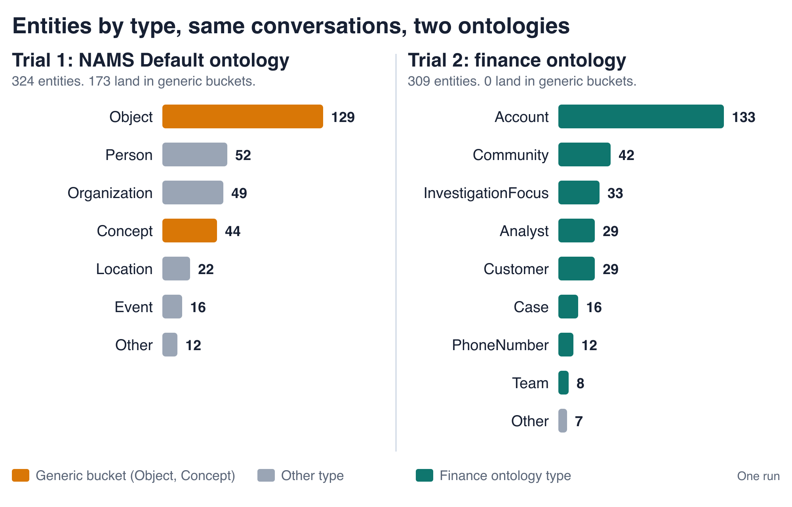

# Agents That Remember What the Team Learned

Agent Bricks, Neo4j, Genie, and Neo4j Agent Memory

<!--
The fraud graph answers structure. Genie answers values. Memory
carries findings from one analyst to the next. That is the whole
talk in three sentences. The rest of the deck shows each part
working and then shows what an ontology changes about the memory.
-->

---

## Every Session Starts Cold

- An analyst finds a suspicious community on Monday.
- A second analyst on another team opens the same community on Wednesday.
- Without memory, the agent re-runs the work.
- The second analyst never sees the first finding.
- **Chat history belongs to one session.** Investigations belong to the team.

<!--
Set up the problem in human terms before any architecture. The
Monday and Wednesday analysts come back on slide 11, where the
second analyst gets the first analyst's finding without re-running
it. Hold the last line: session history and team knowledge are
different things, and this deck is about the second one.
-->

---

## Recap: The Fraud Graph and the Gold Columns

- Accounts connect through transfers, merchants, phones, and addresses.
- Neo4j GDS writes `risk_score`, `community_id`, and `similarity_score` into Gold tables.
- Genie queries those columns like any other dimension.
- The new module adds an agent on top of both the graph and the Gold tables.

<!--
One slide of recap for people who have not seen the enrichment
deck. The full pipeline is in slides.md and slides-15min.md in
this folder. The point to land: the graph and the Gold tables
already exist, and the agent is a new consumer of both.
-->

---

## Architecture

- A Databricks App runs the agent on Agent Bricks.
- The agent reads Neo4j through a Unity Catalog MCP service.
- The agent asks a Genie space for values over the Gold Delta tables.

<!--
The diagram carries the rest: NAMS stores conversations, reasoning
traces, and entities, and MLflow tracing records every model call
and tool call. The agent itself is an OpenAI Agents SDK loop with
two read-only graph tools and the Genie tools. The NAMS key lives
in a secret scope that the app reads as MEMORY_API_KEY.
-->

---

## Structure to the Graph, Values to Genie

- **Structure questions go to read-only Cypher.** An example is "Which customers share this phone number?"
- **Value questions go to Genie.** An example is "What is the average balance by region?"
- **Mixed questions use both in order.** The graph finds the account ids, and Genie gets those ids in its question.
- **The MLflow trace shows each call.** A `read_neo4j_cypher` span covers the graph, and a `genie_ask` span covers Genie.

<strong>PLACEHOLDER: MLflow trace screenshot</strong>
Demo step 5. One trace with a span ending in <code>read_neo4j_cypher</code> followed by a <code>genie_ask</code> span. Replace with <code>./mlflow-trace-step5.png</code>.

<!--
This routing is what makes the two sources better together. The
system prompt tells the agent which kind of question goes where.
Demo step 5 is the mixed case: which phone numbers are shared by
more than one customer, and what are the balances and 30-day
transaction counts of those accounts. The Genie question names the
account ids that the graph found. The Gateway adds a prefix to the
tool name, so the full span name ends in read_neo4j_cypher.
-->

---

## Two Kinds of Memory, One Turn

- **Short-term memory is one analyst's stored conversations.** The app reads the two latest before each turn.
- **Long-term memory is the entity graph in NAMS.** Every analyst's conversations feed it.
- **Agent Bricks keeps one session's history.** NAMS holds what outlives the session.
- **Recall goes into the agent's instructions, not its input.** The session store does not save it again.
- **After the reply, the app writes the turn to NAMS.** One conversation holds two messages and, when tools ran, a reasoning trace.

<!--
Walk the diagram left to right. Recall first: the app lists the
analyst's conversations and reads the latest two, and it searches
the entity graph for the terms the prompt names. Then the agent
runs with that text in its instructions as background. Then the
app answers the caller. Then it writes the turn to NAMS. Agent
Bricks keeps the session history and the MLflow traces on its own,
which is why recall stays out of the message input.
-->

---

## What Gets Saved, and What Does Not

- **The stored answer drops Cypher code fences and MCP tool names.** Without that cleanup, NAMS would extract them as entities.
- **The reasoning trace keeps one plain-sentence step per tool call.** The query text stays out.
- **The MLflow trace keeps the full Cypher.** That is where debugging happens.
- **The system prompt fixes the id format.** Ids are written as "Account <id>" and "Community <id>", so extracted names stay consistent.

<strong>PLACEHOLDER: NAMS console screenshot</strong>
One analyst's conversations, one reasoning trace, and the entities NAMS found. Replace with <code>./nams-console.png</code>.

<!--
NAMS extracts entities from whatever it stores, so what the app
writes decides what the memory graph contains. A trace step reads
like "The agent queried the graph database." Ids, scores, and
counts stay in the answer text. The NAMS console on the right is
what an analyst sees: each question as its own conversation, with
its messages, its trace, and the entities extracted from it.
-->

---

## Memory Follows the Caller's Identity

- **In the deployed app, the server picks whose memory a turn uses.** It reads the forwarded Databricks identity.
- **A caller cannot read another analyst's memory by sending a different `user_id`.** The deployed app ignores it.
- **Recall treats memory as data.** The agent verifies facts against the graph.
- **If NAMS is slow or down, the agent answers without memory.** NAMS never breaks an answer.

<!--
The local server honors a body user_id, and so does the deployed
app for callers listed in MEMORY_TRUSTED_CALLERS. That is how the
traffic generator runs several synthetic analysts. Backup slide B4
covers both, with the header names and the recall limits.
-->

---

## Demo: Recall Across Sessions

- **Step 2 asks whether Account 15940 is a hub.** The answer names Community 19766.
- **Step 3 starts a new session and asks "What was I looking at last time?"**
- **The answer names Account 15940.** This session never did.

<!--
Run: uv run scripts/demo.py --step 2 3

The step 2 question starts with "I focus on hub accounts", and
that phrase is what makes the step 3 recall visible. Point to the
ids, not the wording. The answer text changes from run to run.
Open the step 2 MLflow trace to show the span ending in
read_neo4j_cypher. Steps 2 and 3 use conversation recall, which
reads the stored conversation right away, so this demo does not
wait for extraction. Run the two steps back to back, because
recall reads only the two latest conversations.
-->

---

## The Entity Graph Belongs to the Team

<strong>PLACEHOLDER: Aura graph view</strong>
One entity in the center, a message on each <code>EXTRACTED_FROM</code> arrow, and a conversation behind each message, captioned with its analyst id. Replace with <code>./aura-entity-graph.png</code>.

- **One entity sits in the center.** A message hangs on each `EXTRACTED_FROM` arrow.
- **Each message leads back to a conversation.** The caption is its analyst id.
- **Nobody queried for this graph.** It came from storing conversations.

<!--
Say this: "The conversation history belongs to one analyst. This
entity graph belongs to the team. Nobody queried for it. It fell
out of storing conversations." The screenshot comes from the Aura
Query tab on the NAMS database, with the Conversation caption set
to userId. make who-shares lists the entities that more than one
analyst's conversations fed, and the top row is the one to show.
-->

---

## Demo: One Analyst's Finding Reaches Another

- **Analyst A asked about Community 3040 and its accounts before the talk.** NAMS has already extracted Community 3040 from that turn.
- **Analyst B now asks "What is already known about Community 3040?"** This is a new session and a different user.
- **The answer lists earlier findings it did not re-run.** Analyst B shares no history with analyst A.

<!--
Before the talk: uv run scripts/demo_longterm.py --turn 1
That call asks as analyst A and waits until NAMS has extracted
the entity.

Live: uv run scripts/demo_longterm.py --turn 2 --analyst-b <fresh id>

Say on stage that turn 1 ran earlier. Hiding it would look like a
trick. The facts in the answer came from the entity graph. The
demo depends on the make traffic run having filled the graph
first. A two-turn run on an empty NAMS produced no merged entity
at all. Pass a fresh --analyst-b every time, so analyst B has no
earlier demo turns of their own to recall.

PLACEHOLDER: paste the recorded turn 2 output here as the fallback
if the live call fails or times out.
-->

---

## What an Ontology Is

- **An ontology is a list of entity types and relationships.** It tells NAMS what to look for.
- **The finance ontology has types such as Analyst, Team, Account, Community, Case, and PhoneNumber.**
- **It has relationships such as `MEMBER_OF`, `OWNS`, `INVESTIGATES`, and `PART_OF`.**
- **It describes what analysts talk about.** It is not the fraud graph schema.

<!--
NAMS extracts entities from conversation text, not from the
graph. So the ontology lists the things analysts say: who they
are, which team they are on, what they investigate, and the
accounts, communities, phones, and cases they name. Analyst
covers managers too, because analysts name the person they report
to. Backup slide B3 shows the full list.
-->

---

## Each Type Says What It Is and What It Is Not

> A Louvain community of accounts found by graph analysis, identified by a numeric id such as 'Community 24683'. Not an organization, a team, or an identity cluster.

- **A Customer is an account holder.** It is not an analyst and not the bank's own staff.
- **These descriptions go straight to the extractor.**
- **The ontology runs in permissive mode.** It guides extraction and rejects nothing.

<!--
The quotation is the Community type's description, word for word
from ontology/finance_genie.ontology.yaml. Every type has one. The
"not" half matters as much as the first half. Permissive mode
means an entity outside the list is still stored. The ontology
shapes extraction. It is not a schema check.
-->

---

## The Experiment: Same Conversations, Two Ontologies

- **The input is a set of synthetic analyst conversations.** Analysts on different teams investigate the same community.
- **Trial 1 runs the conversations live with the generic NAMS Default ontology.**
- **Trial 2 replays the same stored conversations with the finance ontology.**
- **Only the ontology and the extraction change between the trials.**

<!--
An agent gives a different answer each time and extraction is LLM
based. So the agent runs live once, in trial 1, and trial 2
replays the stored transcripts unchanged. The database is reset
between the trials, but a reset keeps the active ontology, so
trial 1 is the generic default and not "no ontology". Backup
slide B6 has the caveats. The traffic is synthetic. Do not quote
sizes.
-->

---

## Results: Generic Buckets Become Finance Types

- **Generic entities fell from 173 to 0.**
- **Type conflicts fell from 20 to 1.**
- **Type accuracy rose from 0.714 to 1.**
- **Duplicate groups did not improve.** They went from 64 to 71.
- **These numbers come from one run.**

<!--
These numbers come from one reference run. Extraction is LLM
based, so a rerun gives different numbers. The direction is what
holds. Recall stayed at 1 on both sides, and instance coverage did
not change. The ontology changed how entities were typed, not
whether they were found. Say the duplicates line out loud. The
slide is stronger with the limit on it than without. Backup slide
B2 has the rest of the rows.
-->

---

## What the Ontology Changes in Long-Term Memory

- **Recall finds an entity by name with or without the ontology.**
- **What changes is what comes back with it.** It returns the type, and the description the extractor wrote under that type's guidance.
- **"Community 3040 (Community)" with a description of the investigation tells the model more than "Community 3040 (Object)".**
- **Fewer type conflicts mean fewer cases where one name is split across types.** That split is what makes a keyword search return the wrong node.
- **Typed relationships make the memory graph queryable by people.** A person can ask who investigates a community, or which team an analyst is on.
- **The agent's recall sees names, types, and descriptions.** It does not see relationships.

<!--
This is the honest version of "why the ontology matters". It does
not make recall find more. It changes what a found entity says
about itself, and it makes the graph legible to a human running a
query. The typed relationships are read through GET
/v1/entities/graph, which ontology/measure_ingestion.py uses for
the gold rel typed rows. The who-shares query does not need them.
Duplicates got worse in the reference run. The comparison shows
change, not cause.
-->

---

## Limits to Know

- **Entity recall needs an entity name in the prompt.** A prompt without one gets conversation recall only.
- **Extraction merges some mentions and leaves others as duplicates.** Several nodes can share the same name.
- **Extraction is asynchronous.** New entities appear seconds to minutes after a turn.
- **On hosted NAMS, long-term memory is the entity graph.** Preferences and facts need the self-hosted backend.

<!--
NAMS entity search matches keywords, so the app pulls short terms
such as "Community 3040" out of the prompt instead of searching
the full sentence. The duplicates are why slide 10 uses make
who-shares to find the merged entity instead of searching by name. The async lag is why turn 1 of that demo runs before the
talk.
-->

---

## Key Takeaways and Try It

- **The agent sends structure to the graph and values to Genie.** Every call shows in MLflow.
- **Short-term memory carries one analyst across sessions.**
- **Long-term memory is a graph.** It carries findings across analysts.
- **An ontology types that graph.** It adds finance types and relationships.

- **Project:** [neo4j-mcp-graph-agent on GitHub](https://github.com/neo4j-partners/graph-on-databricks/tree/main/finance-genie/neo4j-mcp-graph-agent)
- **Quick start:** The README runs the agent locally with `make dev` or deploys it with `make deploy`.
- **Memory console:** [memory.neo4jlabs.com](https://memory.neo4jlabs.com/)

<!--
The README quick start comes first. The ontology example and the
long-term memory demo follow, in that order, from the README's
"Ontology and long-term memory" section.
-->

---

# Backup

The following slides cover the demo steps, the metric definitions, the full ontology, the recall limits, and the experiment caveats.

---

## B1. The Five Demo Steps

| Step | Question | Evidence |
|---|---|---|
| 1. Shared phone | Which customers share phone 312-555-0142, and which community are their accounts in? | Accounts 368, 927, 1033, and 1696, then Community 8174. A span ending in `read_neo4j_cypher`. |
| 2. Hub | Is Account 15940 a hub, and which community is it in? | Community 19766. A span ending in `read_neo4j_cypher`. |
| 3. Recall | What was I looking at last time? | Account 15940, in a new session. |
| 4. Genie value | Average balance by region and account type. | A `genie_ask` span, then a `genie_query_result` span. |
| 5. Graph and Genie | Which phones are shared, and what are those accounts' balances and 30-day counts? | A `read_neo4j_cypher` span, then a `genie_ask` span that names the account ids. |

<!--
Run all five with uv run scripts/demo.py, or pick steps with
--step. Steps 1 and 2 share one session. Step 3 starts a new
session, and steps 4 and 5 stay in it. The script prints a "You
should see" list for each step. It cannot read MLflow, so open the
latest traces and check the spans yourself.
-->

---

## B2. What the Metrics Mean

- **Generic-bucket share:** This is the share of entities typed `Object` or `Concept`.
- **Type conflicts:** These are the same name stored under several types.
- **Noise:** This counts entities that are tool or schema plumbing.
- **Instance coverage:** This counts entities for specific instances, such as "Community 3040" or "CASE-4001".
- **Conformance:** This is the share of entities whose type the ontology declares.
- **Ground truth:** The traffic knows every entity it mentions, so recall and type accuracy can be scored.

- **Conformance:** It rose from 0 to about 0.997.
- **Typed relationships:** `MEMBER_OF`, `REPORTS_TO`, `OWNS`, and `INVESTIGATES` each reached 1. They started at 0 or 0.333.
- **Recall:** It stayed at 1 on both sides.
- **Instance coverage:** It did not change.
- **Noise:** It was 0 on both sides.
- **Total entities:** They went from 324 to 309. Do not read much into a change of this size.

<!--
Left column: the definitions from "What the metrics mean" in
ontology-experiment.md. Right column: the rows that slide 15
leaves out. All numbers are from the one reference run.
-->

---

## B3. The Full Ontology

**Types:** Analyst, Team, InvestigationFocus, Account, Customer, Merchant, Community, IdentityCluster, PhoneNumber, Address, and Case.

Each type carries a pole type for NAMS, such as person, organization, object, or location, and a description that says what it is and what it is not.

- `Analyst -[MEMBER_OF]-> Team`
- `Analyst -[REPORTS_TO]-> Analyst`
- `Analyst -[FOCUSES_ON]-> InvestigationFocus`
- `Analyst -[OWNS]-> Case`
- `Customer -[OWNS]-> Account`
- `Analyst -[INVESTIGATES]-> Community | Account`
- `Case -[INVESTIGATES]-> Community`
- `Account -[PART_OF]-> Community | IdentityCluster`
- `Customer -[HAS_PHONE]-> PhoneNumber`
- `Customer -[HAS_ADDRESS]-> Address`
- `Account -[TRANSACTED_WITH]-> Merchant`
- `Account -[TRANSFERRED_TO | SIMILAR_TO]-> Account`

<!--
The source is ontology/finance_genie.ontology.yaml. Team also
carries aliases for the short team names, but the hosted API spec
does not model aliases, so the service may ignore them. The Team
description lists the aliases as a fallback.
-->

---

## B4. Recall Limits and Identity

- **Recall waits at most 10 seconds.** It adds at most 2000 characters to the instructions.
- **The deployed app takes the user from `X-Forwarded-Email`.** It falls back to `X-Forwarded-User` when the email is missing.
- **A request without a forwarded identity gets a 401.**
- **The local server honors a body `user_id`.** Without one, it uses the session id as the user.
- **Callers listed in `MEMORY_TRUSTED_CALLERS` may set `user_id` on the deployed app.** That is how the traffic generator runs several synthetic analysts.

<!--
The match on MEMORY_TRUSTED_CALLERS is exact. The checked-in
values belong to this repo's workspace, so anyone running traffic
replaces them with their own service principal id and email. A
recovery run reads memory but does not write, so a replayed turn
is not saved twice. Evaluation calls the agent directly and never
writes to NAMS.
-->

---

## B5. Add NAMS as a Databricks MCP Service

- **An MCP service exposes the NAMS tools to other Databricks agents.** The Playground can use them as a Unity Catalog object.
- **The service points at `https://memory.neo4jlabs.com/mcp` with a bearer token.** The token is the NAMS key.
- **Trim the tool list after loading.** Deselect the `memory_ontology_*` tools and `memory_create_relation`, because their schemas break the Playground listing.
- **Grant `USE CONNECTION` to each caller.**
- **Try it in the Playground.** Ask the model to remember a fact, then recall it in a new chat.

<!--
This step is optional. The app in this repo calls NAMS directly
through agent/nams.py. The doc is docs/nams-mcp-service.md in the
module. It has sample questions for the Playground, such as
remembering that Community 19766 is under investigation and
recalling it in a new chat.
-->

---

## B6. Experiment Caveats

- **A reset keeps the active ontology.** Trial 1 ran with the generic NAMS Default ontology, not with no ontology.
- **There is no API to unbind an ontology.** A no-ontology baseline only works on a workspace that never activated one.
- **Results vary between runs.** Extraction is LLM based, so two replays of the same side differ.
- **The reference after snapshot held extra smoke-test conversations.** They can only add to the count rows.
- **The comparison shows change, not cause.**

<!--
Each snapshot records the active ontology version id, so the two
versions can be checked. If they match, trial 2 did not activate
the finance ontology and the comparison is invalid. To measure the
noise floor, repeat one side and compare it with itself. A change
between the sides that is smaller than that spread is noise.
-->
