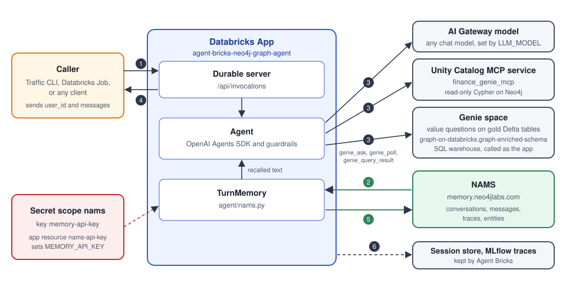

# neo4j-mcp-graph-agent

This is a fraud analyst agent built on Agent Bricks. It reads the finance-genie fraud graph in Neo4j through a Unity Catalog MCP service. It asks a Genie space for values over the gold Delta tables. The agent sends structure questions to the graph and value questions to Genie, and that routing is what makes the two better together. It remembers each analyst's earlier questions in NAMS, the hosted [Neo4j Agent Memory Service](https://memory.neo4jlabs.com/). MLflow tracing records every model call and tool call, so you can see how each answer was found.

What you'll see:

- **Graph and Genie answers:** The agent answers structure questions with read-only Cypher and value questions with Genie. Each MLflow trace shows which source it called and what it asked.
- **Memory across sessions:** A new session picks up what the same analyst asked before.
- **Memory you can inspect:** NAMS shows each analyst's conversations, reasoning traces, and the entities it found.

## Table of contents

- [Architecture](#architecture)
- [Prerequisites](#prerequisites)
- [Set up the NAMS key](#set-up-the-nams-key)
- [Quick start with make](#quick-start-with-make)
- [Clean up](#clean-up)
- [Demo script](#demo-script)
- [Run locally](#run-locally)
- [Documentation](#documentation)

## Architecture



The parts:

- **Caller:** The caller is any client that sends questions, such as the CLI, the traffic generator, or a Databricks Job.
- **Databricks App:** The app is the deployed agent, served by the Agent Bricks `DurableAgentServer`.
- **Agent:** The agent is an OpenAI Agents SDK loop with two read-only graph tools and the Genie tools.
- **TurnMemory:** This class in `agent/nams.py` recalls memory before a turn and writes the turn to NAMS after it.
- **AI Gateway model:** This model writes the answer. The default is `claude-sonnet-5-5`.
- **MCP service:** The Unity Catalog service `finance_genie_mcp` runs read-only Cypher on Neo4j.
- **Genie space:** The Genie space answers value questions over the gold Delta tables.
- **NAMS:** NAMS stores conversations, messages, reasoning traces, and entities.
- **Secret scope `nams`:** This scope holds the NAMS key, which the app reads as `MEMORY_API_KEY`.

[How memory works](docs/how-memory-works.md) walks through one turn step by step.

## Prerequisites

- **Tools:** You need Python 3.11 or newer, [uv](https://docs.astral.sh/uv/), [jq](https://jqlang.org/), and the [Databricks CLI](https://docs.databricks.com/aws/en/dev-tools/cli/install).
- **Agent Bricks CLI:** The CLI is in Beta. Install it with `uv tool install databricks-agentbricks`, or run it with `uvx --from databricks-agentbricks agentbricks ...`.
- **Workspace:** The workspace needs Databricks Apps and Unity Catalog AI Gateway.
- **MCP service:** The service `graph-on-databricks.finance_genie.finance_genie_mcp` must exist. It must expose the tools `get_neo4j_schema` and `read_neo4j_cypher`. [Create the finance-genie MCP service](docs/mcp-service.md) covers the setup.
- **Grant right:** You must own the MCP service or have `MANAGE` on it. Deploy grants `EXECUTE` on it for the app.
- **Genie space:** The agent asks the AFTER Genie space from finance-genie, which covers the gold tables. Set your own space id in the `genie` tool block of `agent.toml`. Deploy grants the app `CAN_RUN` on the space. Then `make grant-genie` grants the warehouse and table access that Genie needs.
- **NAMS key:** You need a NAMS key from https://memory.neo4jlabs.com/. [Set up the NAMS key](#set-up-the-nams-key) covers it.

## Set up the NAMS key

The agent reads the NAMS key from the `MEMORY_API_KEY` environment variable. Run these steps from the `neo4j-mcp-graph-agent/` directory. The local path needs steps 1 and 2. The deployed app needs all four.

1. **Create the NAMS key:** Make a key at https://memory.neo4jlabs.com/.
2. **Save the NAMS key locally:** Copy `.env.example` to `.env`, put the key in `.env` as `MEMORY_API_KEY`, and set `DATABRICKS_CONFIG_PROFILE` there too. [Quick start with make](#quick-start-with-make) step 1 covers it.
3. **Save the NAMS key in Databricks:** Run `make secrets`. It reads `MEMORY_API_KEY` from `.env` and saves it as the Databricks secret `nams/memory-api-key`. It creates the secret scope `nams` if needed.
4. **Attach the NAMS key to the app:** `make deploy` does this for you. On the first deploy, it adds the app resource `nams-api-key`, which points at the secret `nams/memory-api-key` with `READ` permission. To check it, open the app's Resources tab and look for `nams-api-key`.

Where each command reads the NAMS key:

- **From `.env`:** `setup_secrets.sh`, `agent-evaluate`, and the ontology scripts read `.env`. A value exported in your shell wins over `.env`.
- **From your shell:** `agentbricks dev` reads the NAMS key only from your shell. Export `MEMORY_API_KEY` before you start it.
- **From the app resource:** The deployed app reads the NAMS key from the `nams-api-key` resource.

## Quick start with make

Run these steps from `neo4j-mcp-graph-agent/`. [What the make targets run](docs/reference.md#what-the-make-targets-run) shows the raw commands behind each target.

1. **Set your variables:** Two variables drive everything below. `DATABRICKS_CONFIG_PROFILE` is your Databricks profile, and `databricks auth profiles` lists them. `MEMORY_API_KEY` is your [NAMS key](#set-up-the-nams-key). Copy the example file, fill in both values, then load them into your shell. Run the last line again in every new terminal.

   ```bash
   cp .env.example .env
   # edit .env: set DATABRICKS_CONFIG_PROFILE and MEMORY_API_KEY
   set -a; source .env; set +a
   ```

   The `make` targets and the scripts read `.env` themselves. The commands in this README that you type by hand use `$DATABRICKS_CONFIG_PROFILE` from your shell.

2. **Install and sign in:** Install the tools in [Prerequisites](#prerequisites), then sign in to Agent Bricks.

   ```bash
   uv tool install databricks-agentbricks
   agentbricks login --profile "$DATABRICKS_CONFIG_PROFILE"
   ```

3. **Save the NAMS key in Databricks:** This saves `MEMORY_API_KEY` from `.env` as the Databricks secret `nams/memory-api-key`.

   ```bash
   make secrets
   ```

4. **Deploy:** This deploys the app `agent-bricks-neo4j-graph-agent` and prints its URL. On the first deploy, it also attaches the NAMS key and deploys again.

   ```bash
   make deploy
   ```

5. **Grant Genie access:** This grants the app what Genie needs to run its SQL. Run it once after the first deploy. It is safe to run again, and `make grant-genie DRY_RUN=1` only prints the grants.

   ```bash
   make grant-genie
   ```

6. **Test:** `make smoke` asks the app one question in a new session. `make logs` streams the app logs until you press Ctrl-C. Set another question with `make smoke QUESTION="..."`.

   ```bash
   make smoke
   make logs
   ```

7. **Fill NAMS with traffic:** This step is optional. It sends 24 fake analyst turns through the app. [Generate traffic](docs/traffic.md) covers larger runs and the Databricks Job. Laptop traffic calls the app as you, and the app honors the synthetic analyst ids only from callers listed in `MEMORY_TRUSTED_CALLERS`. Otherwise it saves every turn under your own user. So first add your Databricks user email to that entry in `app.yaml`, and separate the values with commas. The checked-in values belong to this repo's workspace, so replace them with your own. The first command prints your email.

   ```bash
   databricks current-user me -p "$DATABRICKS_CONFIG_PROFILE" -o json | jq -r .userName
   ```

   ```yaml
   - name: MEMORY_TRUSTED_CALLERS
     value: <SP_CLIENT_ID>,<your-email>
   ```

   The match is exact, so copy the email as printed. Leave out `<SP_CLIENT_ID>` if you do not run traffic as a Databricks Job. Then deploy again and run the traffic.

   ```bash
   make deploy
   make traffic
   ```

## Clean up

Run these from `neo4j-mcp-graph-agent/` with the variables from [Quick start with make](#quick-start-with-make) loaded. The first command also starts you over if a deploy fails and you want a fresh app.

1. **Delete the app:** This deletes the app `agent-bricks-neo4j-graph-agent` and its Agent Bricks Runtime Store. The command asks you to confirm. Add `--yes` to skip the prompt.

   ```bash
   agentbricks --profile "$DATABRICKS_CONFIG_PROFILE" deployments delete agent-bricks-neo4j-graph-agent
   ```

   **If `deploy` or `delete` fails with "Runtime Store ... does not belong to this app identity":** A Runtime Store with the same name was left behind by an earlier app that was deleted outside `agentbricks`. The store belongs to a service principal that no longer exists, so the CLI refuses to reuse or delete it. To confirm, read the store. Its `owner.app.service_principal_id` differs from your app's `service_principal_client_id`.

   ```bash
   databricks api get /api/2.0/agents/runtime-stores/agent-bricks-neo4j-graph-agent -p "$DATABRICKS_CONFIG_PROFILE"
   databricks apps get agent-bricks-neo4j-graph-agent -p "$DATABRICKS_CONFIG_PROFILE" -o json | jq -r .service_principal_client_id
   ```

   If the two ids differ and the old owner is gone, delete the orphaned store directly. This also deletes the store's database, and it skips the CLI's ownership check, so confirm the ids first. Then run `make deploy` again.

   ```bash
   databricks api delete /api/2.0/agents/runtime-stores/agent-bricks-neo4j-graph-agent -p "$DATABRICKS_CONFIG_PROFILE"
   ```

2. **Delete the NAMS secret:** This deletes the secret scope `nams`, which holds the NAMS key. Skip it if you plan to deploy again.

   ```bash
   databricks secrets delete-scope nams -p "$DATABRICKS_CONFIG_PROFILE"
   ```

3. **Delete the NAMS data:** The conversations from your runs stay in NAMS. Remove them in your NAMS workspace at https://memory.neo4jlabs.com/, or revoke the key there.

To deploy again after a cleanup, start at step 3 of [Quick start with make](#quick-start-with-make). A new app has a new service principal, so run `make grant-genie` again after the deploy.

## Demo script

Ask each question with the `invoke` command that `make smoke` runs, shown in [What the make targets run](docs/reference.md#what-the-make-targets-run), and put the question in `content`. Keep the same `SESSION_ID` unless a step says to start a new one. You can also run `make smoke QUESTION="..."`. It starts a new session for every question, so ask the step 1 extra beat with the raw command in the same session. The evidence is the ids and the spans in the MLflow trace, not the exact answer text.

1. **Shared phone:** Ask "Which customers share phone 312-555-0142, and which accounts do they own?" Several customers share this phone. Look for Accounts 368, 927, 1033, and 1696 and a `read_neo4j_cypher` span. For an extra beat, ask which community those accounts are in. Look for Community 8174.
2. **Hub:** Ask "I focus on hub accounts. Is Account 15940 a hub, and which community is it in?" Look for Community 19766 and a `read_neo4j_cypher` span.
3. **Recall:** Run `SESSION_ID=$(uuidgen)` to start a new session, then ask "What was I looking at last time?" Look for Account 15940 in the answer, although this session never named it. Recall reads only your two latest conversations, so run steps 2 and 3 back to back.
4. **Genie value question:** Ask "What is the average account balance by region and account type?" Look for a `genie_ask` span followed by a `genie_query_result` span.
5. **Graph and Genie:** Ask "Which phone numbers are shared by more than one customer, and what are the balances and 30-day transaction counts of the accounts those customers own?" Look for a `read_neo4j_cypher` span, then a `genie_ask` span whose question names the account ids that the graph found.
6. **NAMS view:** Open your NAMS workspace and find your user, which is your Databricks email. Each turn above is its own conversation, with its messages and a reasoning trace. Entities such as Account 15940 and Community 19766 appear after NAMS extracts them, so they lag the write.

**Optional ring question:** After step 3, ask "Is Community 3040 a fraud ring candidate?" Look for Community 3040 and a `read_neo4j_cypher` span.

## Run locally

Run the agent on your laptop with memory on. This path uses two terminal windows, because the server keeps running.

1. **Install and sign in:** Do step 2 of [Quick start with make](#quick-start-with-make).
2. **Set up the NAMS key:** Do steps 1 and 2 of [Set up the NAMS key](#set-up-the-nams-key).
3. **Start the server (window 1):** Export `MEMORY_API_KEY` in this shell. `agentbricks dev` reads the NAMS key only from the shell, and it stops with an error if the key is missing.

   ```bash
   export MEMORY_API_KEY=<your-nams-key>
   agentbricks dev          # serves http://localhost:8000
   ```

4. **Ask a question (window 2):** Export `DATABRICKS_CONFIG_PROFILE` in this shell too, then send a request.

   ```bash
   agentbricks endpoint invoke --url http://localhost:8000 --path /api/invocations \
     --json '{"id":"'$(uuidgen)'","session_id":"demo-1","input":[{"role":"user","content":"Which communities look like fraud ring candidates?"}]}'
   ```

5. **See recall:** Send a `user_id` next to `messages`. Then send a second question with a new `session_id` and the same `user_id`. The second answer uses the hub focus from the first question. A body `user_id` works locally. A deployed app takes the user from the caller's identity, as [What gets recalled](docs/how-memory-works.md#what-gets-recalled) explains.

   ```bash
   agentbricks endpoint invoke --url http://localhost:8000 --path /api/invocations \
     --json '{"id":"'$(uuidgen)'","session_id":"demo-1","input":{"user_id":"analyst-7","messages":[{"role":"user","content":"I focus on hub accounts. Which accounts act as hubs?"}]}}'
   ```

To run the tests and the CLI check, see [Develop and test](docs/reference.md#develop-and-test).

## Documentation

- [How memory works](docs/how-memory-works.md): This page walks through one turn and shows what NAMS saves and recalls.
- [Generate traffic](docs/traffic.md): The traffic generator runs from your laptop or as a Databricks Job.
- [Run the ontology example](docs/ontology-experiment.md): Two trials, without and with the ontology, show how it drives the schema.
- [Add NAMS as a Databricks MCP service](docs/nams-mcp-service.md): Other agents, such as the Playground, can use the NAMS tools.
- [Create the finance-genie MCP service](docs/mcp-service.md): The agent reads the graph through this Neo4j MCP service.
- [Reference](docs/reference.md): This page covers configuration, guardrails, evaluation, tests, delete, layout, and notes.
- [Troubleshooting](docs/troubleshooting.md): This page shows how to update the MCP connection and check the deployed MCP server image.
