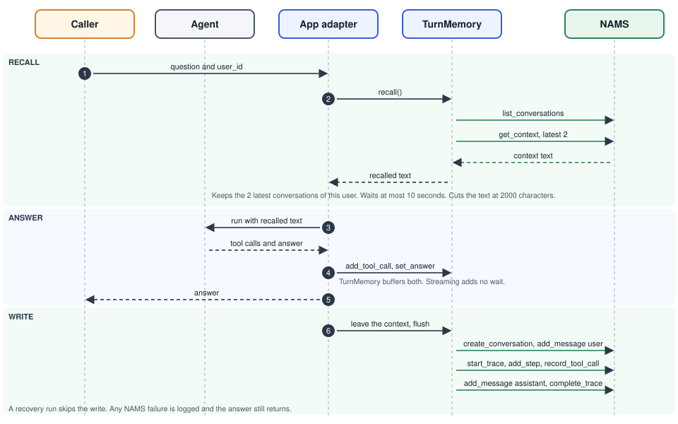

# How memory works

The app uses NAMS as long term memory. It saves every turn and reads recent turns back before it answers. The AWS `fraud-memory-agent` demo only saves. This sample also recalls.

- **Per analyst:** The agent remembers each analyst. After every turn, the app saves the question and the answer to NAMS. Before every turn, it reads the analyst's two latest conversations back.
- **Server-chosen identity:** The app decides whose memory a turn uses. In a deployed app, that is the caller identity the Databricks Apps proxy forwards, so a caller cannot read another analyst's memory by sending their `user_id`.
- **Entities:** NAMS finds entities such as accounts, communities, and cases in the saved conversations. An optional ontology tells it what to look for. The [ontology experiment](ontology-experiment.md) measures what it changes.

How one turn flows:

1. **Request:** A caller sends a question. The app takes the memory user from the caller's forwarded identity. Locally, it uses the `user_id` in the request body. [What gets recalled](#what-gets-recalled) has the details.
2. **Recall:** The app opens a `TurnMemory` for the turn. It lists the user's conversations in NAMS and reads the latest two. It also searches the long-term entity graph for the entities the prompt names.
3. **Run:** The app runs the agent with the recalled text in its instructions. The agent asks the model and reads the graph through the MCP service.
4. **Buffer:** The app hands each tool call and the final answer to `TurnMemory`. It holds them in memory.
5. **Reply:** The app sends the answer to the caller.
6. **Write:** `TurnMemory` saves the turn to NAMS as one conversation with two messages and a reasoning trace.
7. **History:** Agent Bricks keeps the session history and the MLflow traces.

## What gets saved

- **One conversation per turn:** Each turn is its own conversation in NAMS. Each one carries the memory user in its `user_id` metadata, and recall filters on it.
- **Clean answer:** The stored assistant answer has Cypher code fences and MCP tool names removed. `sanitize_answer` in `agent/nams.py` does this, because NAMS would otherwise extract Cypher and tool names as entities. Plain fences, such as result tables, keep their text. Ids, scores, and counts stay in the text.
- **Trace:** When the agent uses tools, the app saves one reasoning trace. The trace has one step and one tool call for each MCP call. Steps use the bare tool name and a plain sentence, such as "The agent read the graph schema." A Cypher tool call is saved without its query, so NAMS does not extract the query as entities. The MLflow trace keeps the full Cypher for debugging. NAMS keeps the steps and tool calls, but not the trace task or outcome.
- **Entities:** NAMS finds entities in the messages on its own servers, and the app does nothing for this. The system prompt asks the agent to write ids the same way each time, as "Account <id>" and "Community <id>". That keeps the extracted names consistent.

## What gets recalled

- **Conversations:** Before the agent runs, the app lists the user's latest conversations and reads the last two.
- **Entities:** The app pulls terms such as "Community 3040" out of the prompt and searches the long-term entity graph for each one. NAMS builds this graph from every analyst's conversations, so entities carry findings across users. The NAMS entity search matches keywords, so the app searches short terms instead of the full prompt. [Long-term memory](longterm.md) shows two demos of this.
- **Where recall goes:** The recalled text goes into the agent instructions as background. It stays out of the message input, because Agent Bricks saves input to the session store.
- **User:** In a deployed app, the user is the caller's `X-Forwarded-Email` header, or `X-Forwarded-User` when the email is missing. The app ignores a `user_id` in the request body, unless the caller is listed in `MEMORY_TRUSTED_CALLERS`. A request without a forwarded identity gets a 401. Locally, send `user_id` next to `messages`. Without it, the app uses `session_id` as the user, and recall finds only turns from that session.
- **Limits:** Recall waits at most 10 seconds and adds at most 2000 characters.

## When NAMS is not available

- **Best effort:** If the NAMS key is missing, or NAMS is slow or down, the agent answers without memory. NAMS never breaks an answer.
- **Retries:** A recovery run reads memory but does not write. A replayed turn is not saved twice.
- **Evaluation:** `agent-evaluate` calls the agent directly. It never writes to NAMS.

## Try it

Start the server with [Quick start local with make](../README.md#quick-start-local-with-make), then follow [Run locally](../README.md#run-locally). Its step 2 sends two questions as the same `user_id` in different sessions, and the second answer recalls the first.
